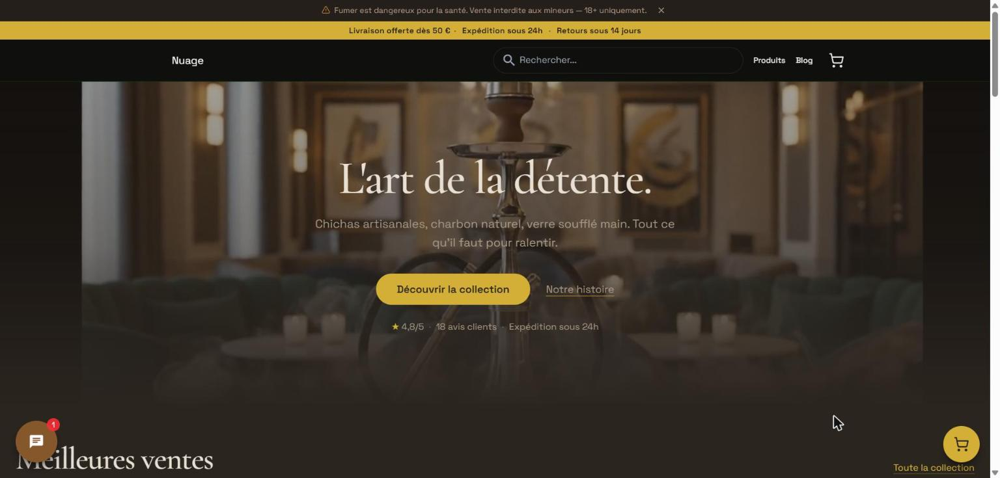
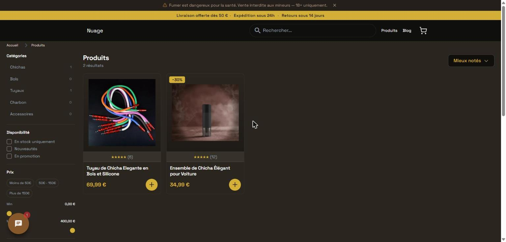
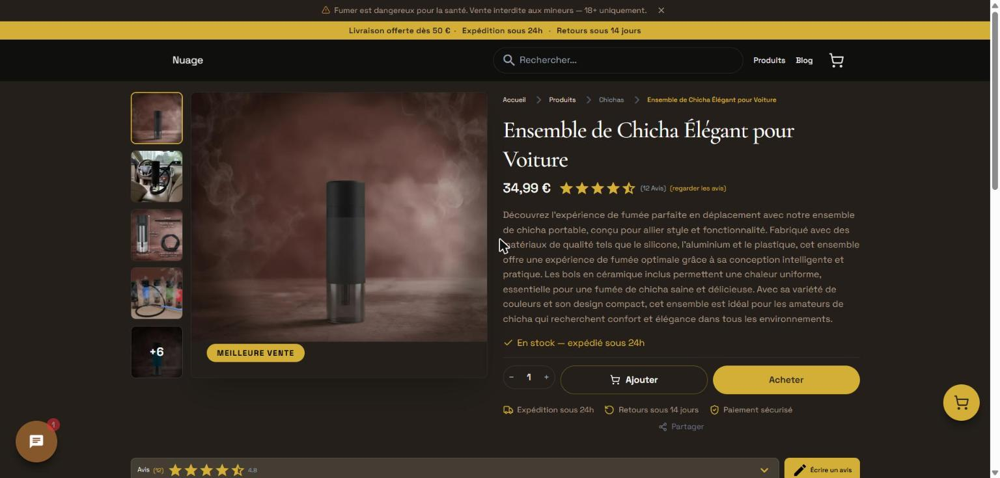
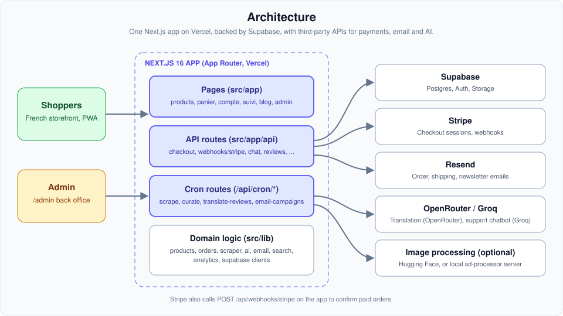
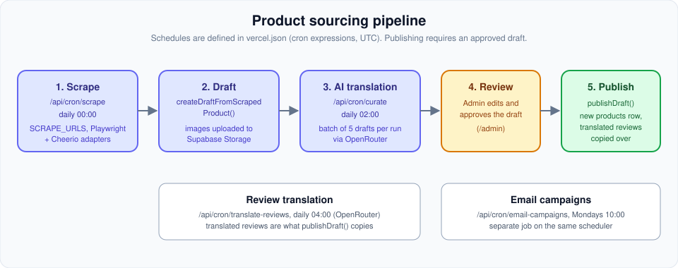

<div align="center">

# Nuage

**Premium chicha e-commerce: a French-language storefront, admin back office and automated product-sourcing pipeline, built on Next.js 16.**


</div>

A full-stack, French-language e-commerce platform for selling hookahs (chichas) and accessories, built with Next.js 16 and the App Router. Beyond a storefront, the project bundles an automated product-sourcing pipeline (scraping, AI curation, review translation, and image processing), an admin back office, analytics, an AI support chatbot, and transactional email — designed to run largely on autopilot via scheduled cron jobs.

**Live site:** <https://chichanuage.com>

<div align="center">

| | |
|:---:|:---:|
| <br>**Home** | <br>**Catalog with filters** |
| <br>**Product page** | <br>**Brand story** |
| <br>**Blog** | |

</div>

<sub>Captured from the live site.</sub>

## Tech Stack

- **Framework:** Next.js 16 (App Router, Turbopack, MDX pages) with React 19
- **Language:** TypeScript 5 (strict)
- **Styling:** Tailwind CSS v4 (`@tailwindcss/postcss`) with the Typography plugin; Framer Motion for animation
- **Backend / Data:** Supabase (`@supabase/ssr`, `@supabase/supabase-js`) — Postgres + Auth + Storage; SQL migrations under `supabase/`
- **Payments:** Stripe (Checkout + webhooks)
- **Email:** Resend with React Email templates (`@react-email/*`)
- **Search:** FlexSearch (client-side full-text search)
- **AI:** OpenRouter (product & review translation), Groq (support chatbot), Hugging Face or a local Stable Diffusion server (`sd-processor/`) for product-image processing
- **Scraping:** Playwright + Cheerio (AliExpress and generic adapters)
- **PWA:** Serwist (`@serwist/next`) service worker with an offline page
- **Auth helpers:** bcryptjs for password hashing
- **Testing:** Vitest
- **Deployment:** Vercel (`vercel.json` defines scheduled cron jobs)

## Features

- **Storefront (French UI):** product catalog and detail pages (`/produits`), cart (`/panier`), wishlist/favorites (`/favoris`), product comparison (`/comparaison`), and account area (`/compte`) with addresses and profile management.
- **Checkout & orders:** Stripe checkout, order confirmation, order tracking (`/suivi`), and email verification of orders. Transactional order/shipping emails via Resend.
- **Admin back office (`/admin`):** dashboards for products, orders, promotions, reviews, newsletter, sourcing/curation, an image processor, a pipeline view, and analytics (revenue, sales, customers, inventory, products, orders).
- **Automated sourcing pipeline:** scrapes supplier/product URLs, curates drafts, AI-translates product data and customer reviews, and processes product images — orchestrated by scheduled cron endpoints under `/api/cron`.
- **AI support chatbot:** floating chat widget backed by a store knowledge base and Groq (see `CHATBOT_README.md`).
- **Analytics & tracking:** first-party event tracking plus optional GA4, Microsoft Clarity, TikTok Pixel, and Meta Pixel (cookie-consent aware).
- **Blog:** MDX articles in `content/blog/` rendered at `/blog`.
- **Newsletter:** subscribe/unsubscribe flows with tokenized links and campaign emails.
- **PWA:** installable app with offline support and generated icons.
- **Legal pages:** CGV, mentions légales, contact (French compliance).

## How it works



The app is a single Next.js deployment. Pages and API routes read and write Supabase (Postgres, Auth, Storage). Checkout creates an order, then a Stripe Checkout session; the Stripe webhook (`/api/webhooks/stripe`) marks the order `confirmed` on `checkout.session.completed` and triggers the confirmation email through Resend.

### Sourcing pipeline



Scheduled cron routes scrape supplier pages into drafts, translate them to French through OpenRouter, and an admin approves a draft before `publishDraft()` turns it into a product. Schedules live in `vercel.json`.

## Project Structure

```
nuage-commerce/
├── src/
│   ├── app/                 # Next.js App Router (pages + API routes)
│   │   ├── admin/           # Admin back office (products, orders, analytics, pipeline...)
│   │   ├── api/             # Route handlers: auth, checkout, webhooks, cron, reviews...
│   │   ├── produits/  panier/  compte/  suivi/  blog/  ...  # French storefront routes
│   ├── components/          # UI: cart, checkout, product, admin, chat, pwa, analytics...
│   ├── lib/                 # Domain logic: products, orders, stripe, email, scraper,
│   │                        #   ai, chatbot, search, supabase clients, analytics...
│   ├── contexts/  hooks/  emails/  data/  types/
├── content/blog/            # MDX blog posts
├── data/                    # Seed/flat-file JSON (products, orders, users, shipping-rates)
├── supabase/                # schema.sql + SQL migrations
├── sd-processor/            # Standalone Python Stable Diffusion image server (optional)
├── scripts/                 # create-admin, generate-icons
├── __tests__/               # Vitest tests
├── public/                  # Static assets
├── next.config.ts  vercel.json  vitest.config.ts  tsconfig.json
```

## Getting Started

Requires Node.js and npm (the repo ships a `package-lock.json`).

```bash
# 1. Install dependencies
npm install

# 2. Configure environment (see below)
cp .env.example .env.local   # then fill in the values

# 3. Set up the database
#    Apply supabase/schema.sql and the files in supabase/migrations/ to your Supabase project

# 4. Run the dev server (http://localhost:3000)
npm run dev

# Other scripts
npm run build        # production build
npm run start        # run the production build
npm run lint         # ESLint
npm run test         # Vitest (run once)
npm run test:watch   # Vitest (watch mode)
```

The optional local AI image processor is a separate Python service — see `sd-processor/README.md`.

## Environment Variables

Copy `.env.example` to `.env.local`. Notable variables referenced by the code:

**Supabase**
- `NEXT_PUBLIC_SUPABASE_URL`
- `NEXT_PUBLIC_SUPABASE_ANON_KEY`
- `SUPABASE_SERVICE_ROLE_KEY`

**Payments (Stripe)**
- `STRIPE_SECRET_KEY`
- `STRIPE_WEBHOOK_SECRET`

**Email & site**
- `RESEND_API_KEY`
- `NEXT_PUBLIC_SITE_URL`

**AI services**
- `OPENROUTER_API_KEY` (product/review translation)
- `GROQ_API_KEY` (support chatbot)
- `HUGGINGFACE_API_TOKEN` and/or `SD_SERVER_URL` (image processing)

**Sourcing & cron**
- `SCRAPE_URLS` (comma-separated URLs to scrape)
- `CRON_SECRET` (protects the `/api/cron/*` endpoints)

**Analytics (optional, consent-aware)**
- `NEXT_PUBLIC_GA_MEASUREMENT_ID`, `NEXT_PUBLIC_CLARITY_PROJECT_ID`, `NEXT_PUBLIC_TIKTOK_PIXEL_ID`, `NEXT_PUBLIC_META_PIXEL_ID`, `NEXT_PUBLIC_GOOGLE_MAPS_API_KEY`

> Note: `.env.example` includes some placeholder/legacy keys (e.g. NextAuth, generic supplier API) that are not necessarily wired into the current code — treat the list above (grepped from `src/`) as authoritative.

## Notes

This repository contains a large set of standalone Markdown documents produced during development and auditing. They are not part of the app but may be useful context:

- **Security:** `SECURITY_AUDIT.md`, `SECURITY_AUDIT_REPORT.md`, `SECURITY_FIXES_GUIDE.md`, `AUDIT_SUMMARY.md`
- **Product/business:** `BUSINESS_ANALYSIS.md` (brand "Nuage"), `REDESIGN_PLAN.md`
- **Features & guides:** `CHATBOT_README.md`, `ANALYTICS_SETUP_GUIDE.md`, `sd-processor/README.md` and `sd-processor/CLOUD-SETUP.md`
- **Testing & progress:** `TESTS.md`, `TESTING_REPORT.md`, `ACTION_PLAN_IMMEDIATE.md`, `QUICK_FIX_CHECKLIST.md`, `IMPLEMENTATION_COMPLETE.md`, `SHIPPING_FIXES_COMPLETE.md`

Scheduled jobs are defined in `vercel.json`: daily product scrape, daily curation, daily review translation, and a weekly email campaign — all calling protected `/api/cron/*` routes.

## License

Released under the [MIT License](LICENSE).

> Running the app locally needs your own Supabase project, because the catalog is read from the database. The screenshots above come from the live site.
